<p align="center">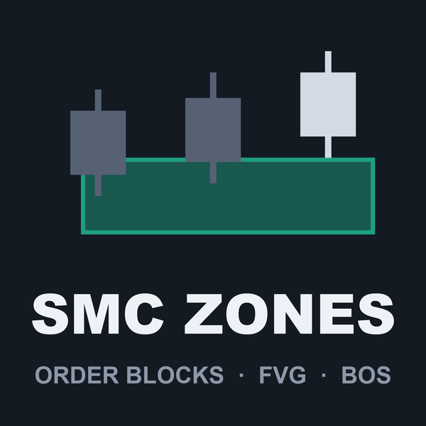</p>

# SMC Zones (MetaTrader 5 and MetaTrader 4)

A free smart-money-concepts indicator that draws **order blocks, fair value gaps and BOS / CHoCH lines**, with optional
liquidity sweeps, a session filter and a higher-timeframe layer, and sends an alert when a zone is created, touched or
mitigated. Every zone is decided **on closed bars only** and never changes afterwards. Source for both editions, a Python
reference of the rules, and the tests that were used to check that MT5, MT4 and Python all agree.

**Website:** [allanninal.dev/mql5 (indicators)](https://www.allanninal.dev/mql5/#indicators) · [MT4 editions](https://www.allanninal.dev/mql5/#mt4) · [allanninal.dev](https://www.allanninal.dev)
· **Contact:** message me on [LinkedIn](https://www.linkedin.com/in/allanninal/).

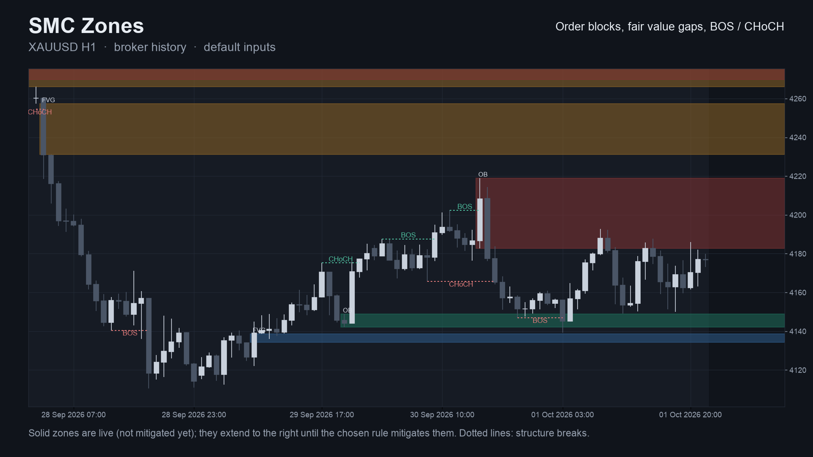

> It is an indicator, not a strategy. It draws zones and lines and places no trades. Nothing here is a profit claim
> (see [Honest limits](#honest-limits)).

## Get it on the MQL5 Market

| Edition | Platform | Price | Link |
|---|---|---|---|
| SMC Zones | MT5 | free | <https://www.mql5.com/en/market/product/201880> |
| SMC Zones MT4 | MT4 | free | <https://www.mql5.com/en/market/product/202375> |
| SMC Session Scanner MT5 | MT5 | paid | <https://www.mql5.com/en/market/product/201879> |
| SMC Session Scanner MT4 | MT4 | paid | <https://www.mql5.com/en/market/product/202425> |

The Market builds are the same calculation as the source in this repository. The scanner is a separate, paid product that
is **not** part of this repository (see [Free vs Pro](#free-vs-pro)).

## Contents

1. [What it is and who it is for](#what-it-is-and-who-it-is-for)
2. [Why it was built](#why-it-was-built)
3. [How it works](#how-it-works)
4. [Non-repainting: the proof and how it was tested](#non-repainting-the-proof-and-how-it-was-tested)
5. [Architecture and buffers](#architecture-and-buffers)
6. [Inputs, alerts, install and compile](#inputs-alerts-install-and-compile)
7. [Run the Python reference and the tests](#run-the-python-reference-and-the-tests)
8. [Honest limits](#honest-limits)
9. [Free vs Pro](#free-vs-pro)
10. [Licence](#licence)

## What it is and who it is for

**What:** the usual smart-money vocabulary, with the rule for each word written down and tested:

- **BOS / CHoCH** lines: a *break of structure* when a close goes beyond the last unbroken swing in the direction of the
  trend, a *change of character* when it reverses the previous break.
- **Order blocks**: the zone left at the start of the leg that broke the swing.
- **Fair value gaps**: a three-candle gap of at least `k x ATR`.
- Optional **liquidity sweeps** (a wick beyond a swing that closes back inside), a **session filter** (only create zones and
  sweeps inside chosen server hours) and **zones of a higher timeframe** drawn as outlines.
- A zone is **mitigated** by the rule you choose: touch, midpoint, far-edge wick, or a close beyond the far edge.

**For:** traders who use these concepts and want to know exactly *when* a zone is created and *when* it ends, and who want
it to stay that way tomorrow. Also for developers who want 16 documented buffers to read with `iCustom`.

**Not for:** anyone who expects a zone to predict a reaction. A zone marks where a rule fired on closed bars.

| | |
|---|---|
| 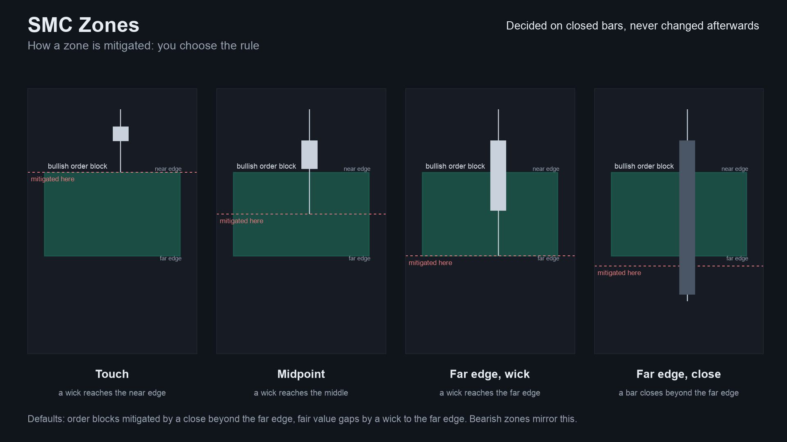 | 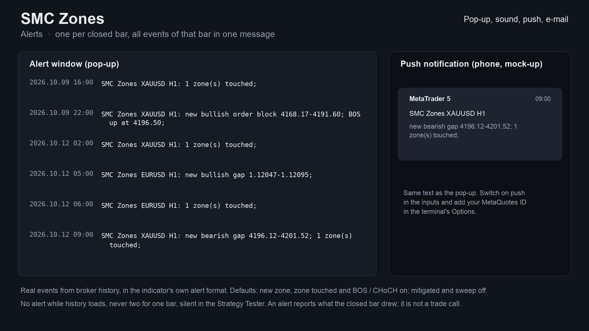 |
| 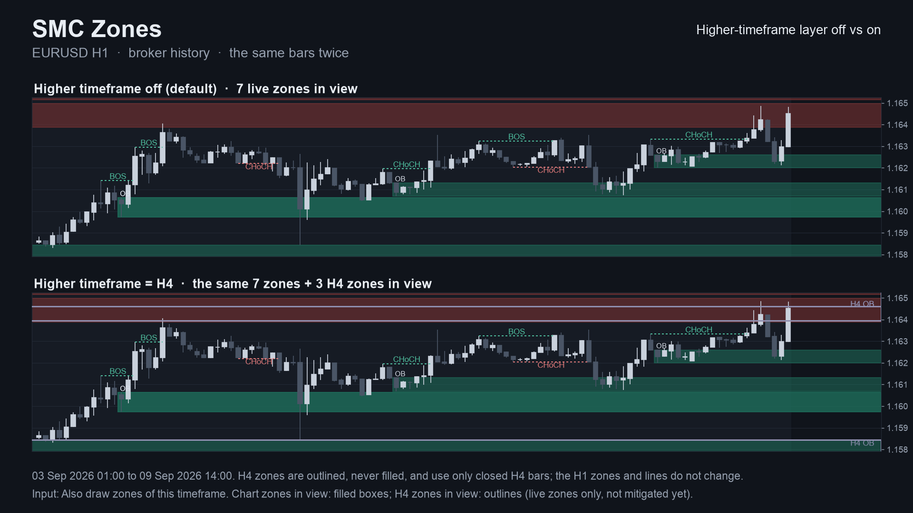 | 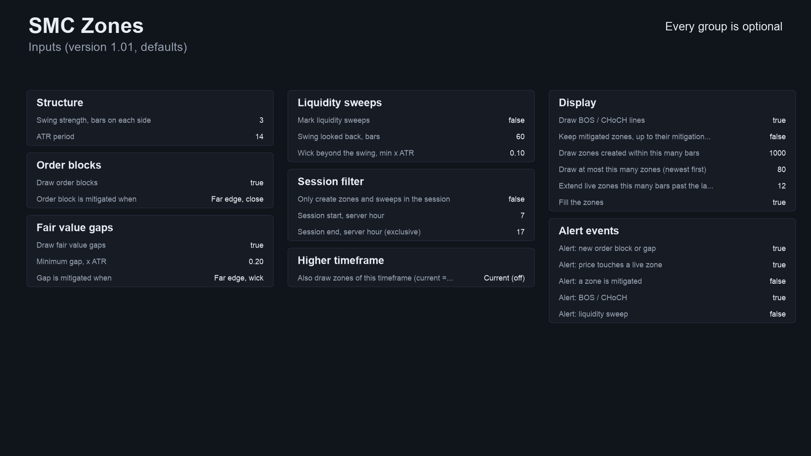 |

Image notes: the charts are drawn by the Python reference on broker history (the same numbers the indicator shows); the alert
text is the indicator's real text but the pop-up and phone card around it are mock-ups; the Data Window panel is a mock-up
of the buffer map. They are illustrations, not terminal captures. More images, including the MT4 versions, are in
[`docs/images/`](docs/images).

## Why it was built

Smart-money indicators are everywhere, so this is not a gap-filling product. The reasons, stated with the evidence we actually have:

- **Crowded, and the claims cannot be checked.** A scan of the MQL5 Market in October 2026 found many free and paid SMC
  tools (the best-known free one has over 50 reviews). Almost all say "non-repainting"; none we read published a test or
  stated when a zone is created. Several did not say what counts as "mitigated".
- **Demand exists but is spread thin.** On the MQL5 Freelance board, 116 of 2,014 scraped jobs (Nov 2025 to Oct 2026) were in
  the SMC / order block / FVG / liquidity group, median budget 50 USD, about 30 applicants per job. People want it; the
  supply side is saturated.
- **So the offer is trust and tidiness, not features.** Exact rules, a test that compares MT5, MT4 and an independent
  Python version bar by bar, and a probe that re-reads every buffer after the bar closed.
- **Free on purpose.** Our own comparison said a new tool cannot be clearly better than the free leader on features, so it is
  free and its value is the evidence.

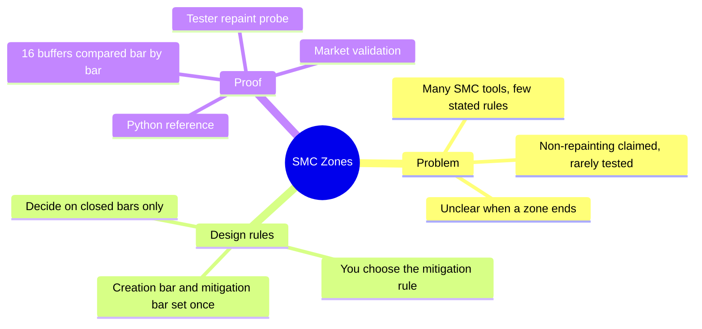

## How it works

### The rules, step by step

Let `O, H, L, C` be a bar's open, high, low, close and `i` the bar index (oldest = 0). Direction `d = +1` is bullish, `-1`
bearish. Everything at bar `i` is decided from bars `0..i` only; the last bar of the chart (the forming one) is never used.

1. **ATR**: Wilder's smoothing of the true range, seeded with the simple average of the first `n` values (default `n = 14`).
2. **Swing**: bar `p` is a swing high if each of the `s` bars to its left has a strictly lower high and each of the `s` bars
   to its right a high not above it (a swing low the mirror). It is known at bar `p + s`, never earlier (default `s = 3`).
3. **BOS / CHoCH**: a close beyond the newest unbroken swing high (bullish) or low (bearish). It is a CHoCH when the previous
   break went the other way, otherwise a BOS. The first break ever is a BOS.
4. **Order block**: take the bar from the broken swing to the break bar with the lowest low (bullish) or highest high
   (bearish), call it `org`. If `org` is a candle against the move, the block candle is the last of the run of
   against-candles starting at `org`; otherwise the nearest against-candle among the 3 bars before `org`; otherwise `org`.
   Bullish zone: top = high of the block candle, bottom = lower of the two lows; bearish is the mirror.
5. **Fair value gap** at bar `i`: bullish if `L[i] - H[i-2] >= k x ATR[i]`, bearish if `L[i-2] - H[i] >= k x ATR[i]`
   (default `k = 0.2`). The zone is the gap.
6. **Liquidity sweep**: a bar wicks beyond an untaken swing (at most 60 bars old) by at least `0.1 x ATR` and closes back
   inside. Every swing wicked through is marked taken, whether or not the bar closed back inside.
7. **Mitigation** (checked on bars after the zone's creation bar), your choice: *touch* (a wick reaches the near edge),
   *midpoint*, *far-edge wick*, or *far-edge close* (a bar closes beyond the far edge). A midpoint exactly on the wick counts,
   within a relative `1e-10`, because `(top + bottom) / 2` can be one unit in the last place off.
8. **Touch**: a bar whose wick reaches the near edge of a live zone that was not already inside on the bar before.
9. **Session filter** (optional): zones and sweeps are only created on bars whose open hour (server time) is inside
   `[start, end)`.

Per bar the engine always runs in this order: mitigation and touch of older zones, sweeps, fair value gap, break and order
block, and then it looks for the swing that became known `s` bars back.

### Per-bar algorithm

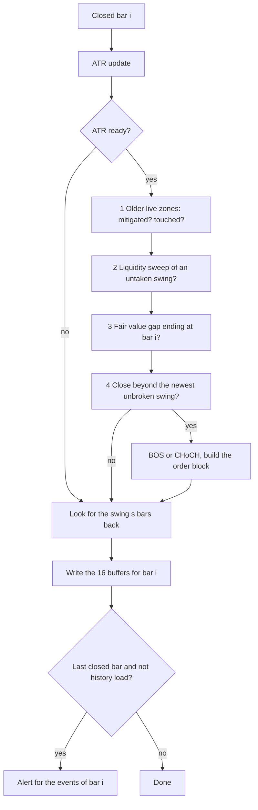

### Zone life cycle

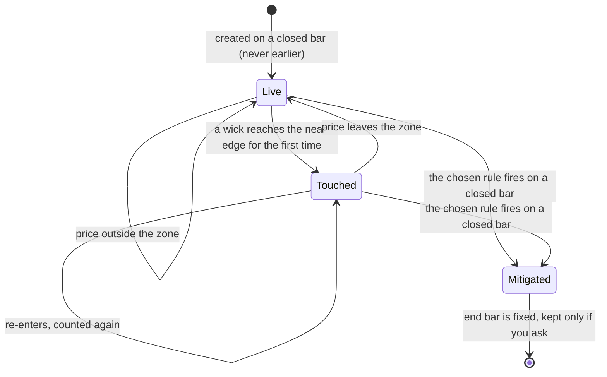

### Alert flow

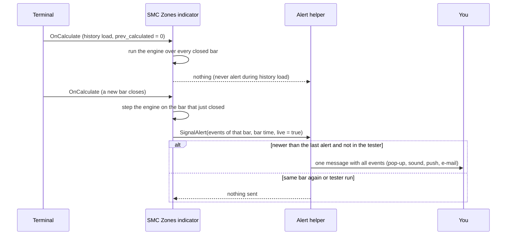

### How many zones the settings make (measured)

Zones created per 1,000 bars on XAUUSD H1 broker history, for three of the input sets used in the tests (order blocks plus
fair value gaps). Source: [`tests/results/parity-mt5.txt`](tests/results/parity-mt5.txt) (68,410 bars each). This counts zones
only. It says nothing about whether they work.

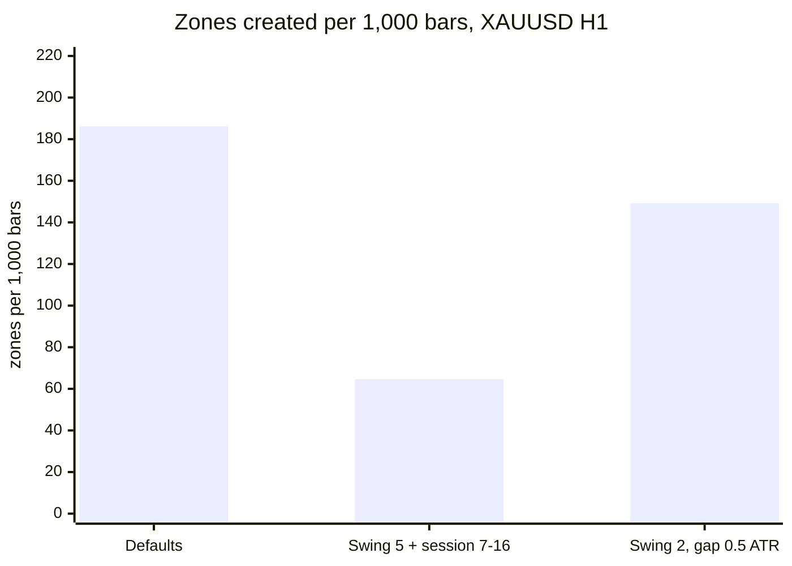

Defaults: swing 3, ATR 14, gap 0.2 x ATR, order block mitigated by a close, gap by a wick. Second: swing 5, touch rules,
session filter 07:00-16:00. Third: swing 2, ATR 10, gap 0.5 x ATR, far-edge wick and close rules.

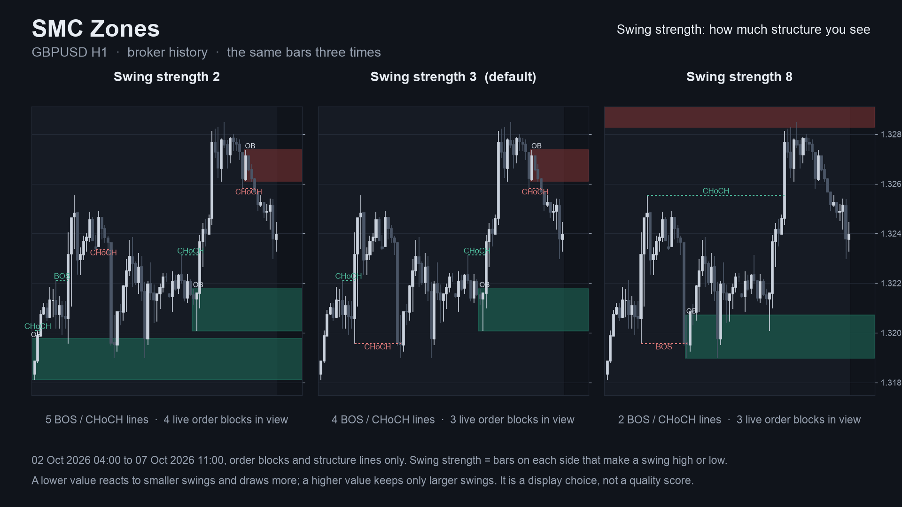

## Non-repainting: the proof and how it was tested

"Non-repainting" is easy to claim. Here is what was actually run. Raw result files are in [`tests/results/`](tests/results).

**1. Three implementations, compared bar by bar.** The Python reference
([`tests/reference.py`](tests/reference.py)) states each rule above in code. The MT5 and MT4 indicators were dumped bar by
bar (all 16 buffers) in the MetaTrader Strategy Tester and [`tests/check_parity.py`](tests/check_parity.py) compared each
dump with the reference. Pass means: on every closed bar every buffer is equal (prices within 1e-9 relative, counts
exactly, empty where the reference has nothing).

| | MT5 | MT4 |
|---|---|---|
| dumps compared | 36 (4 symbols x M15/H1/H4 x 3 input sets) | 37 (the same 36 + one every-tick EURUSD H1) |
| bars compared | 1,122,912 | 761,453 |
| order blocks | 70,816 | 47,570 |
| fair value gaps | 78,770 | 61,946 |
| zones mitigated | 144,950 | 105,899 |
| BOS / CHoCH | 80,616 | 54,733 |
| liquidity sweeps | 41,441 | 26,013 |
| result | ALL PASS | ALL PASS |

Symbols: EURUSD, XAUUSD, GBPJPY, BTCUSD. Input sets: defaults; swing 5 with touch rules and a session filter; swing 2 with a
0.5 x ATR gap and far-edge rules. Sources: [`tests/results/parity-mt5.txt`](tests/results/parity-mt5.txt),
[`tests/results/parity-mt4.txt`](tests/results/parity-mt4.txt). The MT5 and MT4 histories differ in length on the FX pairs,
which is why the bar counts differ.

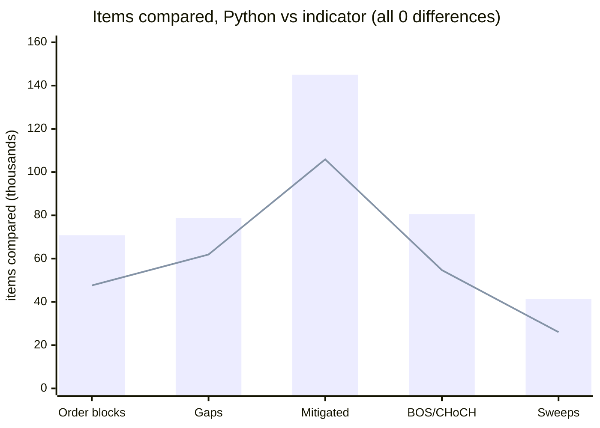

Bars: MT5. Line: MT4.

**2. Repaint probe.** A probe records which signal buffers are set on each bar *at the moment it closes*, then reads the same
bars again at the end and counts any value that changed. It also counts any signal ever shown on the still-forming bar.

| Run | Closed bars checked | Signals seen at close | Changed afterwards | Signals on the live bar |
|---|---|---|---|---|
| MT5, EURUSD H1, every tick, 10,411,052 ticks | 4,644 | 13,988 | **0** | **0** |
| MT4, 37 runs combined | 756,852 | 129,285 | **0** | **0** |

Source: [`tests/results/repaint-summary.md`](tests/results/repaint-summary.md). The MT5 probe ran once (EURUSD H1, default
inputs); the MT4 probe ran on every dump run. "Signals" counts every set value among the probed buffers (new zones, structure
breaks, sweeps).

**3. Market validation.** Both Market builds passed the MQL5 Market's automated product validation before publication (the
Market's own check, not part of this repository).

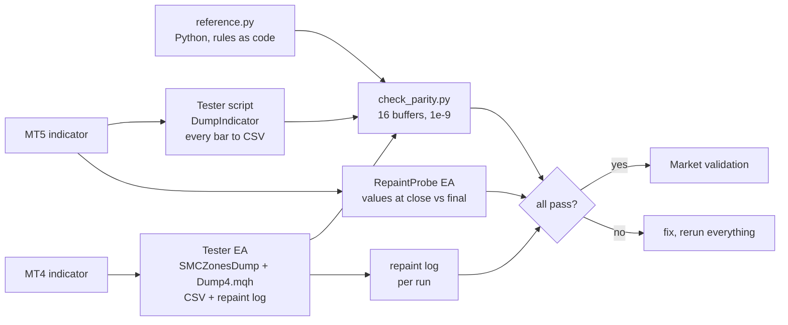

### Why the design cannot repaint

- The engine is a state machine: `Step(i)` reads bars `0..i` only, so what it decided about bar `i` cannot change later.
- A zone's creation bar and its mitigation bar are written once. A swing is only used `s` bars after it formed.
- The forming bar is never stepped; its buffers are always empty.
- Alerts fire only for the bar that just closed, only after the history load, once per bar, and never in the tester.
- What *does* move: the right edge of the drawing (live zones are extended a few bars past the last bar). That is the
  drawing, not a signal.

## Architecture and buffers

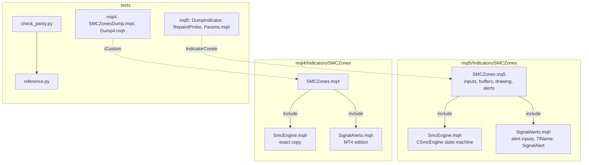

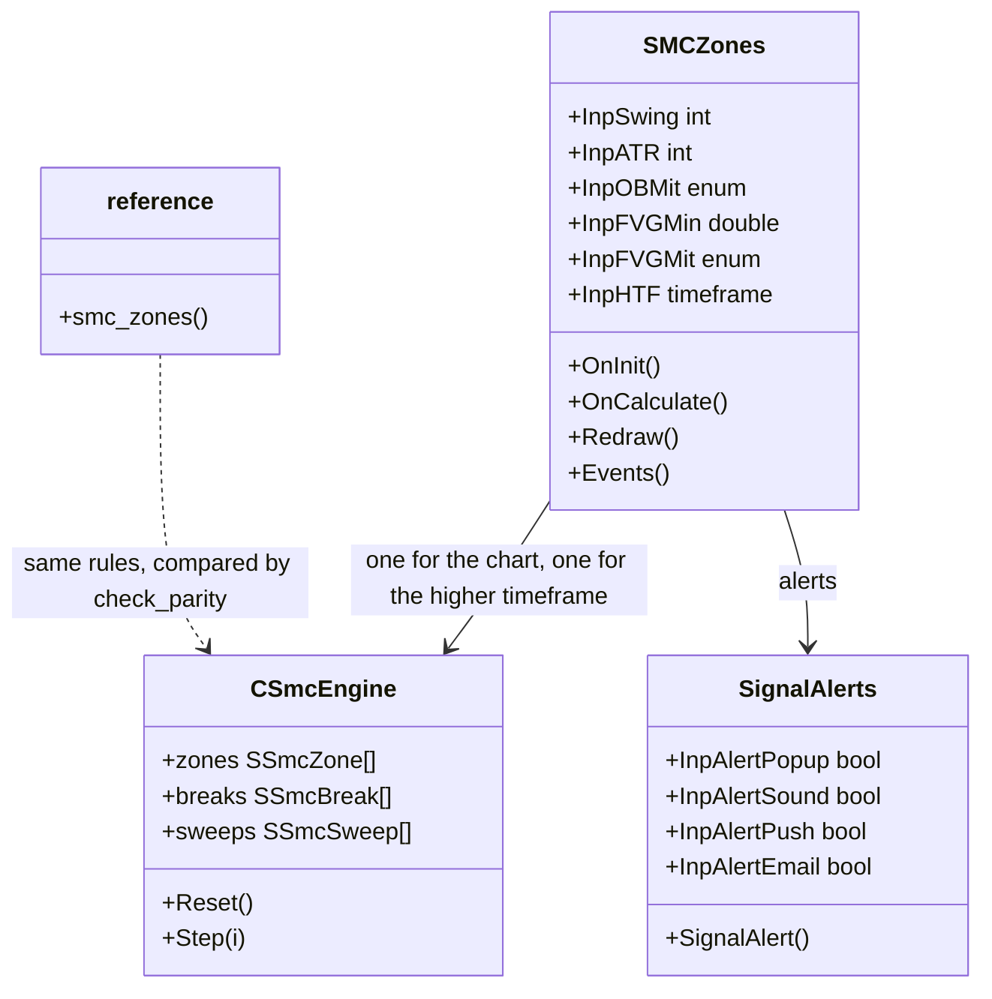

### `iCustom` buffer table (for EA developers)

All 16 buffers are data only (nothing is plotted); the zones are chart objects. Empty value is `EMPTY_VALUE`. Read **closed
bars** (shift 1 and higher). A buffer is set on the bar where the event was decided.

| Buffer | Content |
|---|---|
| 0 / 1 | bullish order block created on this bar: top / bottom |
| 2 / 3 | bearish order block created on this bar: top / bottom |
| 4 / 5 | bullish fair value gap created on this bar: top / bottom |
| 6 / 7 | bearish fair value gap created on this bar: top / bottom |
| 8 | structure: +1 BOS up, -1 BOS down, +2 CHoCH up, -2 CHoCH down |
| 9 | the broken swing's price |
| 10 | sweep of a low (the swing's price), bar closed back above |
| 11 | sweep of a high (the swing's price), bar closed back below |
| 12 | number of zones mitigated on this bar |
| 13 | number of live zones touched for the first time on this bar |
| 14 / 15 | live bullish / bearish zones after this bar |

`iCustom` parameters follow the input order. In MT5 the `input group` headings also count as string parameters when you
build a handle with `IndicatorCreate` (see `tests/mql5/Include/IndTest/Params.mqh`). MT4 has no input groups, and its
buffers are read with the usual series shift.

## Inputs, alerts, install and compile

| Input | Default | Meaning |
|---|---|---|
| Swing strength | 3 | Bars on each side that make a swing |
| ATR period | 14 | Wilder ATR length |
| Draw order blocks / Order block is mitigated when | true / far edge, close | Zone rule |
| Draw fair value gaps / Minimum gap, x ATR | true / 0.20 | Gap size |
| Gap is mitigated when | far edge, wick | Zone rule |
| Mark liquidity sweeps / Swing looked back / Wick beyond the swing | false / 60 bars / 0.10 x ATR | Sweeps |
| Only create zones and sweeps in the session | false (07:00 to 17:00 server hour) | Session filter |
| Also draw zones of this timeframe | current (off) | Higher-timeframe outlines, completed bars only |
| BOS / CHoCH lines, keep mitigated zones | true / false | Display |
| Draw zones created within / at most / extend live zones | 1000 bars / 80 zones / 12 bars | Display limits |
| Fill the zones, colours | true | Appearance |
| Alerts: new zone / touch / mitigated / BOS-CHoCH / sweep | true / true / false / true / false | Which events alert |
| Pop-up / sound / push / e-mail | true / false / false / false | Delivery (push needs your MetaQuotes ID) |

**Install from source.** Copy `mql5/Indicators/SMCZones/` into `<terminal data folder>/MQL5/Indicators/` (MT5) or
`mql4/Indicators/SMCZones/` into `<data folder>/MQL4/Indicators/` (MT4), open `SMCZones.mq5` or `.mq4` in MetaEditor and
press Compile (F7). Both compile with 0 errors (checked with the MetaEditor of a MetaTrader 5 and a MetaTrader 4 build on
a Windows machine; the compiled files are not in the repository). Keep the three files of each edition together.

## Run the Python reference and the tests

```bash
python3 -m venv .venv && . .venv/bin/activate && pip install -r requirements.txt
```

```python
import sys; sys.path.insert(0, "tests")
from reference import smc_zones
# t, o, h, l, c are numpy arrays of bar times (epoch seconds) and OHLC, oldest first; the last bar is the forming bar
buffers, zones, breaks, sweeps = smc_zones(t, o, h, l, c, swing=3, atr=14)
```

To repeat the parity check on your own data:

1. Compile the indicator and the test tool for your platform (`tests/mql5/Scripts/DumpIndicator`, or
   `tests/mt4/SMCZonesDump.mq4` with `tests/mql4/Include/IndTest4/Dump4.mqh` in your `MQL4/Include/IndTest4/`; MT5 also
   needs `tests/mql5/Include/IndTest/Params.mqh`).
2. Run it for each symbol and timeframe with the input sets in `tests/configs.tsv` (MT5) or `tests/mt4/configs.tsv` (MT4).
   Each run writes one CSV per symbol and timeframe, tagged with the config name.
3. `python3 tests/check_parity.py <folder with the CSVs>` (add `--mt4` for MT4 dumps). It prints PASS or FAIL per file.
4. Repaint: run `tests/mql5/Experts/RepaintProbe` in the MT5 Strategy Tester (every tick); MT4 writes its repaint log with the dump.

The price dumps used for the published numbers are not in this repository (they are broker price data).

## Honest limits

- **Zones are not predictions.** Nothing here says a zone holds, that a CHoCH reverses the market, or that a sweep marks a
  turn. The numbers above are about *consistency* and *frequency*, never profit.
- **One reading of smart-money concepts.** There is no standard definition. These are written-down, testable rules; another
  tool's order block can be a different candle and both can be called correct.
- **Most zones end.** In the MT5 test dumps 144,950 of the 149,586 order blocks and gaps created (about 97%) were later
  mitigated. That is how the rules work, not a promise about any one zone.
- **Lag is built in.** A swing is only known `s` bars after it formed, so BOS / CHoCH and the order block appear on the bar
  that breaks it, not when the turn started.
- **Higher-timeframe zones** use completed bars of that timeframe only, so they appear when that bar closes.
- **Scope of the tests.** Four symbols, three timeframes, three input sets, one MT5 repaint run. Other symbols, timeframes
  and settings are not covered by the published numbers. The MT5 build was not run on a live chart as part of these numbers.
- A multi-symbol scanner of structure and session events exists as a separate paid product (see below).

## Free vs Pro

| | Free: SMC Zones | Paid: SMC Session Scanner |
|---|---|---|
| Platforms | MT5 [201880](https://www.mql5.com/en/market/product/201880), MT4 [202375](https://www.mql5.com/en/market/product/202375) | MT5 [201879](https://www.mql5.com/en/market/product/201879), MT4 [202425](https://www.mql5.com/en/market/product/202425) |
| Price | free | paid (see the Market page) |
| What you get | Zones, BOS / CHoCH lines, optional sweeps, session filter, higher-timeframe layer, alerts on the current chart, source here | A multi-symbol, multi-timeframe scanner panel, as described on its Market listing |
| Source | this repository | not published |
| Closed-bar decisions, no repaint | yes | see its listing |

No need to buy the paid product to use the free one: the free indicator is complete on its own.
Website: [allanninal.dev/mql5](https://www.allanninal.dev/mql5/#indicators) ([MT4](https://www.allanninal.dev/mql5/#mt4)).

## Licence

Everything is © 2026 Allan Niñal under the
[PolyForm Noncommercial License 1.0.0](LICENSES/PolyForm-Noncommercial-1.0.0.md): source-available, free for personal and
other noncommercial use, not for commercial use. Each source file has an `SPDX-License-Identifier` line; the text is in
[`LICENSE`](LICENSE). The licence applies to this source, not to anything you build or trade with the indicator. Trading
involves risk; the software is provided as is.

---

**Website:** [allanninal.dev/mql5](https://www.allanninal.dev/mql5/#indicators) · [MT4](https://www.allanninal.dev/mql5/#mt4) · [allanninal.dev](https://www.allanninal.dev)
· Questions: message me on [LinkedIn](https://www.linkedin.com/in/allanninal/).
